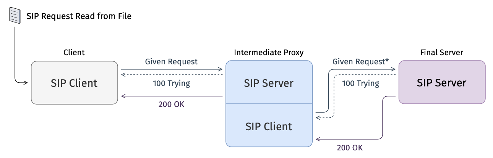

# SIP over UDP: client, proxy, server



## Running

With Docker:

```sh
make up      # builds the image and starts server, proxy and client; the client sends testdata/invite.txt once
make down
```

Locally:

```sh
make build
bin/server -response testdata/200ok.txt
bin/proxy
bin/client -request testdata/invite.txt
```

| Binary | Flag               | Default               | Meaning                                              |
|--------|--------------------|-----------------------|------------------------------------------------------|
| client | `-proxy`           | `127.0.0.1:5060`      | proxy address                                        |
|        | `-request`         | `testdata/invite.txt` | file with the request to send                        |
|        | `-timeout`         | `10s`                 | how long to wait for the final response              |
| proxy  | `-listen`          | `0.0.0.0:5060`        | UDP address to listen on                             |
|        | `-upstream`        | `127.0.0.1:5070`      | server address                                       |
|        | `-via-host`        | `127.0.0.1:5060`      | `host:port` the proxy writes into its `Via`          |
|        | `-transaction-ttl` | `32s`                 | how long the proxy remembers a forwarded request     |
| server | `-listen`          | `0.0.0.0:5070`        | UDP address to listen on                             |
|        | `-response`        | `testdata/200ok.txt`  | file with the final response                         |
|        | `-delay`           | `1s`                  | delay before the final response                      |

The client exits with `0` on a 2xx final response and `1` on any error, a non-2xx final response or a timeout.
The proxy and server run until `SIGINT`/`SIGTERM`, then close the socket and wait for running handlers to return.
Responses that are not sent yet at that moment, such as a delayed `200 OK`, are dropped.

## Development

```sh
make unit         # unit tests with the race detector
make integration  # starts server and proxy with docker compose and runs test/ against them
make test         # all tests; test/ starts local processes instead of containers
make cover        # unit test coverage
make lint         # golangci-lint, pinned version, see .golangci.yml
```
